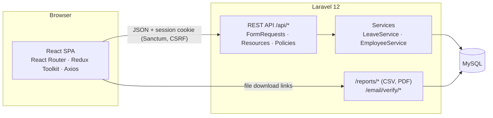
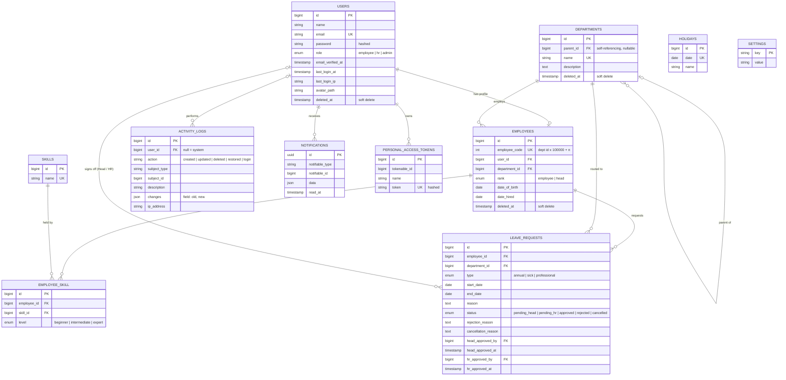

[](https://classroom.github.com/a/lxL_zZuw)

# Crewly — HR Management System

Crewly manages a company's staff, departments and leave. Employees request leave, their Head of Department approves it, and HR gives the final sign-off. Balances are worked out automatically from years of service, working days and public holidays.

**Stack:** Laravel 12 REST API · React 18 single-page app (React Router, Redux Toolkit, Axios) · MySQL 8 · Sanctum authentication

| | |
| --- | --- |
| **Live app** | _Not deployed yet. The URL will be added here._ (see [DEPLOYMENT.md](DEPLOYMENT.md)) |
| **Live API** | _Not deployed yet. The API is served under `/api` on the same domain._ |
| **API documentation** | Postman collection in [`docs/postman/`](docs/postman/) (51 endpoints, each with a real example response) |
| **Tests** | 169 automated tests. See [TESTING.md](TESTING.md) |
| **How the code works** | [docs/HOW_IT_WORKS.md](docs/HOW_IT_WORKS.md): architecture, one request traced through every file, each feature explained, where to change things |

---

## Contents

1. [Features](#features)
2. [Architecture](#architecture)
3. [Installation](#installation)
4. [Roles and permissions](#roles-and-permissions)
5. [API](#api)
6. [Database (ERD)](#database-erd)
7. [Project structure](#project-structure)
8. [AI assistance](#ai-assistance)

---

## Features

**Leave**
- Three leave types: **annual**, which counts against the allowance; **sick**, recorded immediately with a 30-day yearly cap; and **professional**, which has no limit.
- Leave is counted in **working days**. Weekends and HR-defined **public holidays** don't count. HR adds holidays one at a time or **uploads each year's list from Excel or CSV**, using a downloadable template and a preview before saving. A date that's already saved gets the new name; other dates are kept. **Clear all** empties the list before a new year.
- The **annual allowance** depends on years of service: 3 days (under 1 year), 10 days (1–7 years), 15 days (8–15 years) or 20 days (16+ years). Unused days can **roll over** into the next year if HR switches rollover on, up to a maximum HR sets.
- Approval happens in **two steps**: Head of Department, then HR. A Head's own leave goes straight to HR.
- The system refuses requests that exceed the allowance, overlap an existing request, or fall only on weekends or holidays. Employees can cancel their own requests, giving a reason.

**People and organisation**
- Full CRUD for employees, departments and skills. Employee IDs are assigned automatically (department ID × 100000 + a running number).
- Departments form a **hierarchy**: a department can sit inside another.
- **Skills** have a level (beginner, intermediate or expert), and employees can be filtered by skill.
- Deletes are **soft**: deleted employees and departments can be restored, and past leave stays on record.
- Safeguards: the system always keeps at least one Admin and one HR account, and a department with staff always has a Head.

**Everything else**
- **Dashboard** with charts: staff per department and leave by status.
- **In-app notifications** at each step of a leave request (a bell with an unread count).
- **Activity log:** who created, changed, deleted or restored what, with old and new values, plus every sign-in.
- **Reports:** CSV and PDF export of the leave list and the employee list (using the current filters), and a PDF leave record per employee.
- **Accounts:** sign-in, password reset by email, email verification, profile editing and profile photo upload. There is no public sign-up; HR and Admin create the accounts.
- **Search, filtering and pagination**, both server-side (employees, leave, activity) and client-side (instant department search).
- Responsive layout, toasts, loading states, and themed confirmation dialogs.

---

## Architecture



- **Backend:** controllers stay thin. Validation lives in **FormRequest** classes, which have custom messages. JSON output goes through **API Resource** classes. Business rules live in **services**, and permission rules in **middleware** (`role:admin,hr`, `head`) and a **policy** (`EmployeePolicy`).
- **Frontend:** a single-page app served by Laravel at every path. React Router chooses the screen. All core data (employees, leave, departments and so on) lives in the **Redux Toolkit** store, with one slice per feature, loaded through `createAsyncThunk` and Axios.
- **Authentication:** the SPA uses Sanctum's **session cookie** with CSRF protection, so no token is stored in the browser. Other API clients, such as Postman, use a **Sanctum token**.
- **Errors:** every API error has the same JSON shape, `{ "code", "message", "errors" }`. The SPA turns it into field messages or a toast.

---

## Installation

**Requirements:** PHP 8.2+ (with the `pdo_mysql`, `gd`, `fileinfo` and `zip` extensions), Composer 2, Node.js 20+, and MySQL 8. Laragon on Windows includes all of these.

```bash
git clone https://github.com/Leyeft/Re_HR_Management.git
cd Re_HR_Management/hr-system/hr-system

composer install
npm install

cp .env.example .env          # Windows: copy .env.example .env
php artisan key:generate
```

Create an empty MySQL database (for example `hr_system`) and fill in `.env`:

```dotenv
DB_DATABASE=hr_system
DB_USERNAME=root
DB_PASSWORD=
APP_URL=http://127.0.0.1:8000
APP_TIMEZONE=Asia/Bangkok
```

Then create the tables and demo data, link the upload folder, and build the frontend:

```bash
php artisan migrate --seed     # creates the tables + demo company
php artisan storage:link       # makes uploaded profile photos viewable
npm run build
php artisan serve              # → http://127.0.0.1:8000
```

While you edit React code, also run `npm run dev` in a second terminal. To reset to fresh demo data, run `php artisan migrate:fresh --seed`; this **deletes everything** first.

**Demo accounts** (password `password`):

| Email | Role |
| --- | --- |
| admin@test.com | Admin |
| hr@test.com | HR |
| james@test.com | Head of Finance |
| itsupport@test.com | Head of IT Support |
| bobby@test.com | Employee (Finance) |

**Email:** locally `MAIL_MAILER=log`, so password-reset and verification emails are written to `storage/logs/laravel.log`, where you can copy the link.

**Tests:** run `php artisan test`. The tests use an in-memory SQLite database and need neither MySQL nor a frontend build.

---

## Roles and permissions

There are three system roles, Employee, HR and Admin (`users.role`). Separately, any employee can hold the rank **Head of Department** (`employees.rank`). The API checks every permission. The SPA only hides what a user can't use.

| Permission | Employee | Head | HR | Admin |
| --- | :-: | :-: | :-: | :-: |
| Sign in, edit own profile and photo, change password | ✅ | ✅ | ✅ | ✅ |
| See own dashboard, balance and notifications | ✅ | ✅ | ✅ | ✅ |
| Request and cancel own leave¹ | ✅ | ✅ | ✅ | ✅ |
| Approve or reject leave in **own department** (step 1) | — | ✅ | — | — |
| See own department's leave history | — | ✅ | — | — |
| Final leave sign-off (step 2), view all leave | — | — | ✅ | ✅ |
| Company dashboard and charts | — | — | ✅ | ✅ |
| Manage employees, departments and skills; restore deleted | — | — | ✅ | ✅ |
| Leave settings (rollover) and public holidays | — | — | ✅ | ✅ |
| Activity log, CSV/PDF reports | — | — | ✅ | ✅ |
| Create, edit or remove **Admin** accounts; give the Admin role | — | — | — | ✅ |

¹ For accounts linked to an employee record. A Head's own request goes straight to HR.

Rules that apply to everyone:
- HR and Admin accounts can't also be a Head.
- The last Admin and the last HR can't be removed or demoted.
- A department's only Head can't be removed while the department has staff.

---

## API

The base URL is `/api`, and requests and responses are JSON. Send `Accept: application/json`.

**Authenticating**
- **API clients:** call `POST /api/auth/token` with `email`, `password` and `device_name`, then send `Authorization: Bearer <token>`.
- **The SPA:** calls `GET /sanctum/csrf-cookie`, then `POST /api/auth/login`. After that the session cookie and the XSRF token are sent automatically.

**Postman:** import [`docs/postman/Crewly.postman_collection.json`](docs/postman/Crewly.postman_collection.json) and the environment [`Crewly-local.postman_environment.json`](docs/postman/Crewly-local.postman_environment.json). Then:
1. Choose the *Crewly – local* environment.
2. Run **Auth → Get token as Admin**.
3. Work through the folders from top to bottom.

Each request has a saved example response, recorded from the real API.

### Endpoints

| Method | Endpoint | Access | Description |
| --- | --- | --- | --- |
| **Auth** | | | |
| POST | `/auth/token` | public | Get an API token |
| DELETE | `/auth/token` | signed in | Revoke the current token |
| POST | `/auth/login` | public | Sign in with the SPA session cookie |
| POST | `/auth/logout` | signed in | Sign out (SPA) |
| GET | `/auth/me` | signed in | Current user, employee record and permission flags |
| POST | `/auth/forgot-password` | public | Email a reset link |
| POST | `/auth/reset-password` | public | Set a new password with the emailed token |
| **Profile** | | | |
| PUT | `/profile` | signed in | Update name and email |
| PUT | `/profile/password` | signed in | Change password (needs the current password) |
| POST / DELETE | `/profile/avatar` | signed in | Upload (multipart `avatar`) or remove the profile photo |
| POST | `/profile/verification-email` | signed in | Send the email-verification link |
| **Dashboard and notifications** | | | |
| GET | `/dashboard` | signed in | Company figures (Admin/HR) or personal figures |
| GET | `/notifications` | signed in | Notifications (`unread=1`, `page`) and the unread count |
| GET | `/notifications/unread-count` | signed in | Unread count (for the bell) |
| POST | `/notifications/{id}/read`, `/notifications/read-all` | signed in | Mark one or all as read |
| **My leave** | | | |
| GET | `/leave-requests` | signed in | My requests (`status`, `type`, `page`) |
| GET | `/leave-requests/summary` | signed in | My balance by type (`year`) |
| POST | `/leave-requests` | signed in | Request leave |
| POST | `/leave-requests/{id}/cancel` | signed in, owner | Cancel, giving a reason |
| GET | `/holidays` | signed in | Public holidays |
| **Head of Department** | | | |
| GET | `/approvals` | Head | Requests waiting for me |
| GET | `/approvals/history` | Head | All leave in my department |
| POST | `/approvals/{id}/approve`, `/approvals/{id}/reject` | Head | Step 1 decision (reject needs a reason) |
| **HR / Admin** | | | |
| GET | `/hr/leave-requests` | HR, Admin | All leave (`search`, `department`, `status`, `type`, `from`, `to`, `page`) |
| POST | `/hr/leave-requests/{id}/approve`, `/{id}/reject` | HR, Admin | Final decision |
| GET, POST | `/departments` | HR, Admin | List (`search`, `trashed=only`, `per_page=all`) and create |
| GET, PUT, DELETE | `/departments/{id}` | HR, Admin | Show, update (incl. `parent_id`), soft delete |
| POST | `/departments/{id}/restore` | HR, Admin | Restore |
| GET, POST | `/employees` | HR, Admin | List (`search`, `department`, `rank`, `skill`, `sort`, `trashed=only`, `page`) and create |
| GET, PUT, DELETE | `/employees/{id}` | HR, Admin² | Show, update (incl. `skills`), soft delete |
| POST | `/employees/{id}/restore` | HR, Admin² | Restore |
| GET | `/employees/{id}/leave-requests` | HR, Admin | Leave history |
| GET, POST, PUT, DELETE | `/skills`, `/skills/{id}` | HR, Admin | Skills CRUD |
| GET, PUT | `/settings/leave` | HR, Admin | Rollover on/off and maximum days |
| POST, DELETE | `/holidays`, `/holidays/{id}` | HR, Admin | Add or remove a public holiday |
| POST | `/holidays/import` | HR, Admin | Upload holidays from Excel/CSV (multipart `file`; `dry_run=1` = preview only). New dates are added, same dates replaced, others kept |
| DELETE | `/holidays` | HR, Admin | Clear all holidays |
| GET | `/activity` | HR, Admin | Activity log (`search`, `action`, `subject_type`, `user`, `from`, `to`) |
| **Reports** (web routes, signed in with the session) | | | |
| GET | `/reports/leave.{csv\|pdf}` | HR, Admin | Leave report with the same filters as `/hr/leave-requests` |
| GET | `/reports/employees.{csv\|pdf}` | HR, Admin | Employee report with the same filters as `/employees` |
| GET | `/reports/employees/{id}/leave-record.pdf` | HR, Admin | One employee's leave record |
| GET | `/templates/holidays.{xlsx\|csv}` | HR, Admin | Template for the holiday import |

² Only an Admin can change or remove an Admin account.

### Examples

Get a token, then request leave:

```bash
curl -X POST http://127.0.0.1:8000/api/auth/token \
  -H "Accept: application/json" -H "Content-Type: application/json" \
  -d '{"email":"bobby@test.com","password":"password","device_name":"curl"}'
# → 201 { "data": { "token": "3|9Zx…", "token_type": "Bearer", "profile": { … } } }

curl -X POST http://127.0.0.1:8000/api/leave-requests \
  -H "Accept: application/json" -H "Content-Type: application/json" \
  -H "Authorization: Bearer 3|9Zx…" \
  -d '{"type":"annual","start_date":"2026-11-30","end_date":"2026-12-02","reason":"Family trip"}'
```

```json
{
  "data": {
    "id": 11,
    "type": "annual",
    "start_date": "2026-11-30",
    "end_date": "2026-12-02",
    "days": 3,
    "reason": "Family trip",
    "status": "pending_head"
  },
  "message": "Leave request sent to your Head of Department."
}
```

Lists are paginated:

```json
{ "data": [ … ], "links": { "first": "…", "next": "…" }, "meta": { "current_page": 1, "last_page": 3, "per_page": 10, "total": 24 } }
```

### Errors

Every error has the same shape. `code` lets the frontend react to specific cases.

```json
{ "code": "validation_error", "message": "Some fields need attention.", "errors": { "reason": ["Please give a reason."] } }
```

| Status | `code` | When |
| --- | --- | --- |
| 401 | `unauthenticated` | Not signed in, or the token or session has expired |
| 403 | `forbidden` | Signed in, but not allowed. The message explains why, e.g. "Only an Admin can give someone the Admin role." |
| 404 | `not_found` | No such record |
| 419 | `session_expired` | The CSRF token expired (the SPA refreshes it and retries) |
| 422 | `validation_error` | Field errors in `errors` |
| 422 | a business rule, e.g. `not_enough_leave`, `overlapping_leave`, `no_working_days`, `last_admin`, `last_head`, `department_not_empty` | The request is valid but breaks a company rule |
| 429 | `too_many_requests` | Too many attempts (sign-in is limited) |

---

## Database (ERD)

There are 10 application tables, normalised to 3NF, with foreign keys and cascades. Every table has timestamps, except the activity log, which keeps only `created_at` because log lines are never edited. They include a **self-referencing** key (`departments.parent_id`) and a **pivot** table (`employee_skill`, many-to-many with extra data). Soft deletes apply to users, employees and departments.



**Delete behaviour**

| Relationship | On delete |
| --- | --- |
| Deleting a user or employee | Soft delete. Pending leave is cancelled; history is kept. |
| Deleting a department | Blocked while it has employees. Otherwise soft delete, and its sub-departments move up a level. |
| A parent department hard-deleted | `parent_id` is set to null |
| Skills ↔ employees | Pivot rows cascade |
| Leave request → approver user | The approver is set to null; the request stays |

Migrations are in `database/migrations`. Factories (`Department`, `Employee`, `Skill`, `LeaveRequest`) and the `DemoSeeder` build the demo company.

---

## Project structure

```
hr-system/hr-system/
├── app/
│   ├── Http/Controllers/Api/   REST controllers (thin)
│   ├── Http/Requests/Api/      FormRequests — validation + custom messages
│   ├── Http/Resources/         JSON output (API Resources)
│   ├── Http/Middleware/        EnsureRole (role:admin,hr), EnsureDepartmentHead (head)
│   ├── Policies/               EmployeePolicy (Admin-only actions)
│   ├── Services/               LeaveService, EmployeeService — business rules
│   ├── Models/                 Eloquent models (+ Concerns/LogsActivity)
│   └── Notifications/          LeaveUpdate (in-app)
├── database/                   migrations, factories, seeders
├── resources/js/spa/           React SPA
│   ├── api/client.js           Axios instance (CSRF, error shape)
│   ├── store/                  Redux Toolkit slices
│   ├── routes/                 React Router + private-route guards
│   ├── pages/, components/, layouts/
├── resources/views/            spa.blade.php, PDF report templates
├── routes/api.php, web.php
└── tests/                      Unit + Feature (API) tests
```

---

## AI assistance

This project was developed with the assistance of **ChatGPT (OpenAI)** as a development support tool.

ChatGPT was used to:
- Explain Laravel concepts and best practices
- Debug errors and interpret confusing error messages
- Assist in database design and workflow planning
- Help structure documentation and Mermaid diagrams

**Claude (Anthropic)**, through Claude Code, was used during the rebuild into a REST API and React single-page app: implementation support, tests and documentation.

Like any real-world development collaboration, there were moments of miscommunication, iterative clarification, and “wait… that’s not what I meant” discussions.
These moments contributed positively to problem-solving, learning, and refining the final system.

All final decisions, implementations, and integrations were reviewed, understood, and executed by the project author.

AI tools were used strictly as a **learning aid and development sidekick**, in accordance with course guidelines.

## Quote of the project

"Coding is not just about getting things right the first time—it's about laughing at the detours, learning from the bugs, and enjoying the ride." - ChatGPT

## Links

- Current repository: https://github.com/Leyeft/Re_HR_Management
- Earlier version (Blade): https://github.com/Leyeft/HR-Management-System
